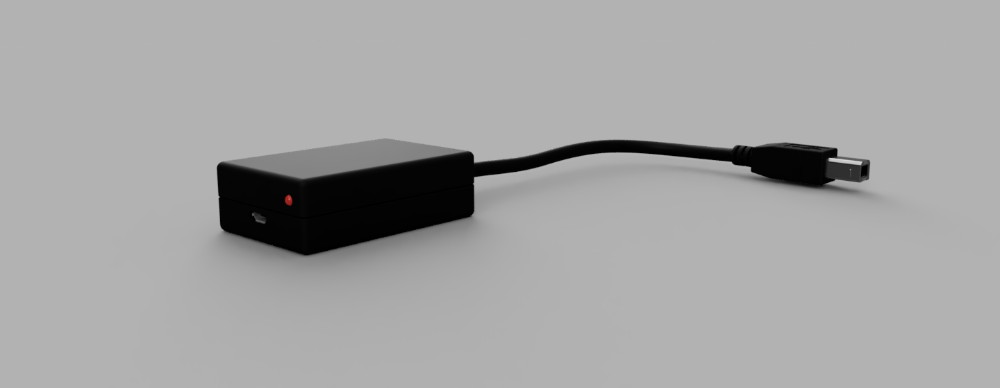
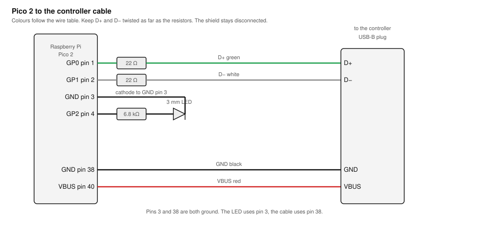
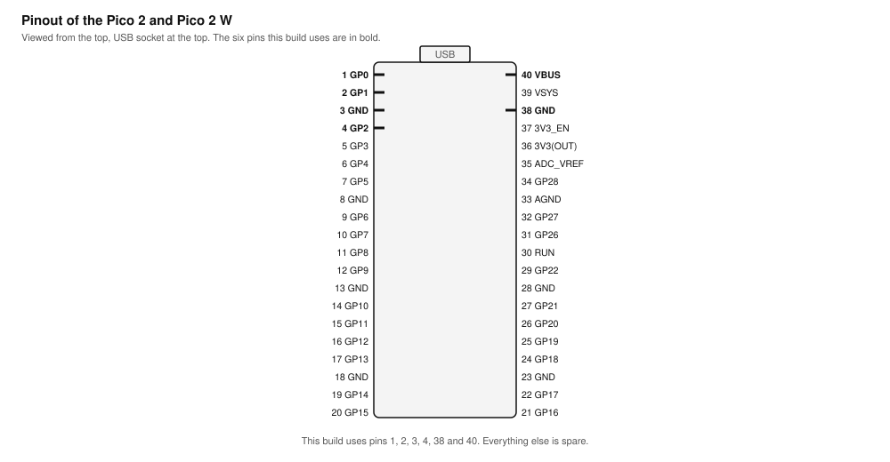
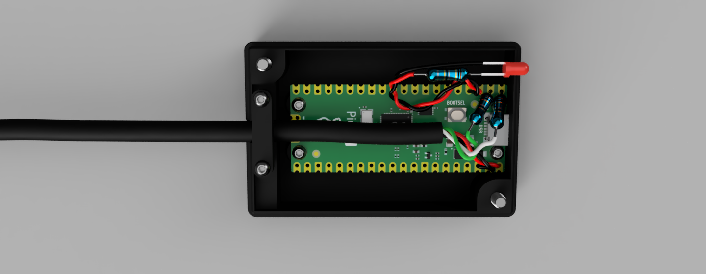
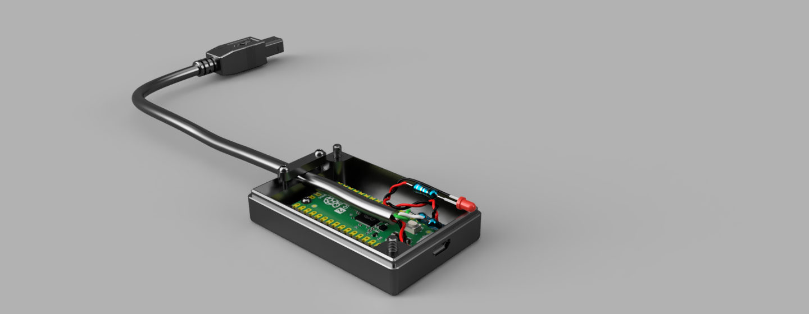
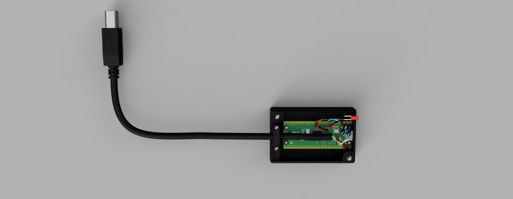

# MixPre Control Surface Bridge

Drive a Sound Devices MixPre from an iCON Platform M+.

A Raspberry Pi Pico sits between the two. On one USB port it pretends to be one
of the controllers the MixPre accepts. On the other it speaks Mackie Control, and
translates between the two protocols.

Firmware version 1.2.2. What changed between versions is in `CHANGELOG.md`, and
any build can be asked which version it is: send `F0 7D 61 F7` to the bridge.



---

## The problem

A MixPre accepts a short list of controllers: the Akai MIDIMix, the Korg
nanoKONTROL 2, the Korg nanoKONTROL Studio and the Novation LaunchControl XL.
Anything else is ignored, no matter how standard the protocol is.

So a surface that is not on that list is useless with a MixPre, and even the
ones that are on it only reach part of what the recorder can do. This project
fixes that with about 10 USD of parts.

## What it does

- 8 faders, which covers every channel of a MixPre-6, with full support for channels 5 and 6
- 8 knobs, each switchable between Trim, LowCut and Pan
- Mute, Solo, Rec arm and Select for every channel, with LEDs
- Full transport: Play, Stop, Record, Rewind, Fast Forward, Cycle, Return to Zero
- Jog wheel for shuttle and scrub
- Slate, Tone and L/R mute
- Fader pairing: up to four groups, so two or more faders move as one
- LEDs on the surface follow the recorder
- Built and tested with the iCON Platform M+ on MixPre-6 and MixPre-10, and used
  over many days on a film production

## What it does not do

Three things, for three different reasons:

- **Motorized faders cannot follow the recorder.** The MixPre reports button
  states only. It never sends fader positions, so the motors can only hold the
  position you set, not mirror the mix.
- **The knobs stay relative.** Knob values are not reported either, so you match
  a knob by turning it until it catches the value the recorder already has.
- **Channels 9 and 10 of a MixPre-10 are out of reach.** The eight faders reach
  channels 1 to 8. A MixPre-6 has six channels, so all of them are covered. A
  MixPre-10 has ten, and the last two are not: a fader that lands on a channel it
  does not already match would jump the level, and the MixPre does no catch-up on
  its faders. The bridge could do that catch-up itself, and a later release may.

Everything else depends on Sound Devices. Official support for controllers other
than the one they whitelist, and value feedback for faders and knobs, are their
call, not something a bridge can work around.

## Hardware

| Part | Notes |
|---|---|
| Raspberry Pi Pico 2 W (or Pico 2) | Pico 2 is enough. The W model has WiFi you will not use |
| iCON Platform M+ | What this was built and tested with. Another Mackie Control surface should work in principle, but the button mapping here is written for the iCON |
| 2 x 22 Ω resistor | Series termination on the two data lines |
| 1 x 6.8 kΩ resistor | Status LED |
| 1 x 3 mm LED | The case has a 3 mm hole for it, so the size matters. Lights steady when the surface is alive, blinks when it is not |
| USB-A to USB-B cable | Cut the USB-A end off, the wires go to the Pico |
| Hookup wire, around 0.25 mm² / 23 AWG, 1.5 mm outside diameter | Two pieces for the LED, about 10 cm each. Twisted or left straight, both work |
| 3D printed case | STL files in `enclosure/` |
| 4 x M2 x 3 mm screw, 3.5 mm head | Holds the Pico in the case |
| 2 x M2 x 10 mm screw | Cable clamp |
| 2 x M3 x 12 mm screw | Lid |

The Pico has one USB controller, so the native USB port is the MixPre side and
the host side runs over PIO USB on two GPIO pins.

### Wiring

| Pico 2 W | part | cable wire |
|---|---|---|
| GP0 (pin 1) | 22 Ω in series, close to the pin | D+ (green) |
| GP1 (pin 2) | 22 Ω in series, close to the pin | D− (white) |
| GND (pin 38) | | GND (black) |
| VBUS (pin 40) | | VBUS (red) |
| GP2 (pin 4) | 6.8 kΩ to the LED anode | status LED |
| GND (pin 3) | | LED cathode |

Pins 3 and 38 are both ground on the Pico. The LED takes pin 3 because the LED
sits on that side of the board, and the cable's ground takes pin 38, which is
next to VBUS where the red wire lands anyway.



Pin numbers in the table and in the drawing are the ones printed on the board. The
drawing below shows where they sit and which side of the board each wire lands on.



The official pinout from Raspberry Pi is worth having open while you solder:
<https://pip-assets.raspberrypi.com/categories/1088-raspberry-pi-pico-2-w/documents/RP-008305-DS-1-pico-2-w-pinout.pdf>

Keep D+ and D− as a twisted pair, untwisted only over the last 2 to 3 cm at the
resistors. The two wires to the LED can be twisted or left straight, it makes no
difference. Keep them away from the data pair.

**Leave the cable shield disconnected.** The iCON does not tie the USB shell to
its signal ground or to its DC input, so there is no ground loop to worry about,
and at Full Speed the twisted pair does the work. Connect the shield to Pico
ground on one end only if you actually hit interference.

## Assembly

Work through it in this order.

1. Cut the USB-A plug off the cable, strip the outer jacket back far enough to
   work with, and find the four wires inside: green, white, black and red. The
   bare shield around them stays unconnected, so trim it back where it cannot
   touch anything.

2. Strip and tin the four wires. Green is D+, white is D−, black is ground, red
   is VBUS.

3. Solder one 22 Ω resistor to pin 1 (GP0) and the other to pin 2 (GP1). Keep
   both right at the pins.

4. Solder the green wire to the free end of the pin 1 resistor, and the white
   wire to the free end of the pin 2 resistor. Keep the pair twisted as far as
   the resistors and untwist only the last 2 to 3 cm.

5. Solder the black wire to pin 38 (GND) and the red wire to pin 40 (VBUS).

6. Solder the 6.8 kΩ resistor between pin 4 (GP2) and the anode of the LED, and
   the cathode of the LED to pin 3 (GND). Pin 3 sits on the same side as the LED,
   which keeps the wire short. Keep these two wires away from the data pair.

7. Slide the Pico into the bottom half of the case and bring the cable out
   through the clamp. Fix the Pico with the four M2 x 3 mm screws and the clamp
   with the two M2 x 10 mm screws, so that a pull on the cable cannot reach the
   solder joints.

8. Close the lid with the two M3 x 12 mm screws.

9. Flash the firmware, see Build below.

10. Power it up with nothing connected on the surface side. The LED blinks until
    the surface answers, and then it stays on.



Two more views. The first is the step that is easiest to get wrong, the cable
clamp and the pull relief it gives the solder joints:



The second shows the finished case from the side, with the cable leaving through
the clamp:



The wiring in these pictures is illustrative. Solder by the table and the diagram
above, not by the colours you see there.

## Build

You do not have to build anything. A ready `prebuilt/mixpre_bridge_1.2.2.uf2` is
in this repository: hold BOOTSEL on the Pico, plug it in, and copy that file onto
the RP2350 drive.

To build it from source instead:

```bash
cd pico-bridge/firmware
export PICO_SDK_PATH=$PWD/../pico-sdk
export PICO_TOOLCHAIN_PATH=/path/to/arm-gnu-toolchain
export PICO_BOARD=pico2_w
cmake -B build -G "Unix Makefiles"
cmake --build build
```

Output: `build/mixpre_bridge_<version>.uf2`, where the version comes from
`pico-bridge/firmware/version.h`. Hold BOOTSEL on the Pico, plug it in, and copy
the file onto the RP2350 drive. The copy kept in `prebuilt/` carries the same
name.

Vendored dependencies are not in the repository. Clone `pico-sdk` and
`Pico-PIO-USB` into `pico-bridge/` before building.

### Controller mode

The iCON has to be in Mackie Control mode. Set it with the iCON software, or with
the mode combination at start-up. The iCON manual covers both.

### MixPre shortcuts you have to set in its menu

The MixPre exposes Tone, L/R mute, Slate and Shuttle only as user assignable
shortcuts. Assign them like this, otherwise those buttons do nothing:

| Shortcut | Assign | Driven by |
|---|---|---|
| Marker Set | Tone | Read, note 74 |
| Marker Left | Slate | Write, note 75 |
| Marker Right | L/R Mute | Mixer, note 84 |
| Fast Fwd | Shuttle | jog wheel push |

Read, Write and Mixer are sent as `Cycle + button` combinations. Read and Mixer
only work while Cycle is engaged, which is a safety measure: it keeps an
accidental press from muting an ISO track mid take. Slate is momentary and works
regardless.

The note numbers are what the controller sends, measured with a MIDI monitor.
Mackie Control calls the third button Mute. The iCON panel labels it Mixer.

### What the buttons do

| Control | What it does |
|---|---|
| Faders 1 to 8 | channel fader |
| Knobs 1 to 8 | Trim, LowCut or Pan, see below |
| Knob push 1 to 8 | change the knob function |
| Channel `<` and `>` | step the knob function back and forward |
| Rec, Solo, Mute, Select 1 to 8 | the matching buttons on the recorder |
| Rewind, Fast Forward, Stop, Play, Record, Cycle | the same transport buttons |
| Marker Set, Next Marker | markers |
| Jog wheel | jog. Pressing the wheel runs the Shuttle shortcut |
| Read | Tone |
| Write | Slate, momentary |
| Mixer | L/R mute |
| Bank `<` and `>` | nothing yet, and they have no LED the host can light |

### What the surface cannot do

A few things on the Platform M+ are out of reach, and they are worth knowing
before you go looking for them:

- **The master fader is not used.** It arrives as Pitch Bend channel 9 and the
  bridge ignores it. The controller scene on the recorder has no master channel.
- **The Bank `<` and `>` buttons have no LED that MIDI can light.** They flash
  locally when pressed, and that is all the hardware does with them.
- **The Zoom buttons send nothing at all** and have no addressable LED either,
  so nothing can be mapped to them.
- **The LED colours are fixed per row.** The lamps are RGB, but the colour
  follows the row rather than the message: neither velocity nor MIDI channel
  changes it, so a row cannot be recoloured from the bridge.

The rows a host can light are the channel rows (Rec, Solo, Mute, Select), the
transport, and the master Read, Write and Mixer buttons. Write is the one lamp
left free in that set, which is why the knob function indicator sits on it.

### The knob function

The knobs carry one of three functions at a time. On the MixPre that is a scene:
Trim, LowCut or Pan. There is one free lamp in the master row, the Write LED, so
it shows which one is active:

| Knob function | Write LED |
|---|---|
| Trim | off |
| LowCut | steady |
| Pan | blinking |

Any knob push button moves to the next function. Channel `<` and `>` step back
and forward one at a time.

### What Cycle unlocks

Cycle is a transport button on the MixPre, and it doubles as the switch that
frees the assignable shortcuts. With Cycle on, Read runs Tone and Mixer runs L/R
mute. Those are the two the recorder only accepts in that mode. Write (Slate) is
momentary, so it works at any time: the bridge pulses Cycle around the click and
puts the mode back exactly as it was.

The same mode guards the Mute row. A channel can only be muted while Cycle is on,
so a knock against the Mute buttons cannot kill an ISO track mid take, while
unmuting always works and a muted channel can always be rescued. The Mute LEDs
follow what the recorder reports.

One more gate: for the first five seconds after the surface appears, the faders
are ignored. The surface runs its own calibration in that window and would
otherwise drag the whole mix to zero.

### Pairing faders

The bridge can tie two or more faders together, so moving one moves all of them.
This is a bridge feature. The MixPre is never told that a group exists.

1. Cycle **off**.
2. Hold **Mixer** and press **knob 1 to 4** to pick one of the four groups.
   The Select LEDs go dark, so it is clear that assigning has started.
3. Still holding Mixer, press **Select** on the channels for that group. The
   Select LEDs show the group as it is built. Pressing one again takes it out.
4. Release Mixer. A group needs at least two channels. Anything smaller is
   dropped, so a half finished gesture leaves nothing behind.

To take a channel out of a finished group, repeat the same gesture on it. If the
group drops below two channels it disappears. Four groups are available, which is
four stereo pairs on the eight faders.

Groups live in memory only. They are gone after the power is cut.

While Mixer is held, the Select buttons belong to the bridge and nothing reaches
the recorder, whose screen would otherwise jump to another channel on every
click. The knob buttons do not change the scene either, which is the whole reason
for grabbing the Mixer first.

**Do not run this together with the channel linking in the MixPre menu. Use one
or the other.** Both tie channels together, and using them on the same pair hands
one fader two rules. The difference is worth knowing when you pick:

| | MixPre channel linking | Bridge pairing |
|---|---|---|
| Trim, LowCut, Pan | shared | not shared |
| Fader | shared | shared |
| Motorized faders | do not follow | follow |

The MixPre's own linking shares more, but the surface faders stop tracking it.
The bridge pairing only ties the faders, and the motors follow them.

## Repository layout

```
pico-bridge/firmware/     firmware sources
pico-bridge/docs/         protocol notes
pico-bridge/README.md     detailed engineering notes
enclosure/                case parts, STL
images/                   pictures of the finished case
docs/                     wiring diagram
prebuilt/                 ready to flash mixpre_bridge_<version>.uf2
```

## How it works

Two things had to be reproduced, and both were reverse engineered on the wire:

1. **The Korg handshake and USB identity.** The MixPre refuses unrecognised
   devices, so the Pico presents the Korg's descriptors byte for byte, answers
   its SysEx handshake and serves the scene and global data the MixPre writes
   back to it.
2. **The translation.** The surface speaks Mackie Control, the MixPre expects CC
   messages from its own scene. Faders, knobs, buttons and the jog wheel are
   mapped in both directions.

Details are in `pico-bridge/README.md` and `pico-bridge/docs/`.

## Debug commands

Send these as SysEx to the bridge over MIDI.

| Command | Effect |
|---|---|
| `F0 7D 61 F7` | firmware version as plain text |
| `F0 7D 67 F7` | status: mount state, VID/PID, counters |
| `F0 7D 65 F7` | registers from the last hard fault |
| `F0 7D 64 vv F7` | force the status LED to level vv, `FF` returns to automatic |
| `F0 7D 7C F7` | return the debug log |
| `F0 7D 7A F7` | reboot |
| `F0 7D 7E F7` | reboot into BOOTSEL |

## Troubleshooting

**The LED blinks and nothing works.** The bridge is not hearing from the
surface. Check that the surface is powered and that its USB cable is seated.

**Buttons do nothing, but the faders work.** The MixPre shortcuts were never
assigned. See the shortcut table above.

**The MixPre does not pick up the surface at all.** The surface has to be in
Mackie mode. See Controller mode above.

**Levels drop to silence the moment the surface connects.** This is the MixPre
protecting your ears, not a fault in the bridge. Whenever the controller mode
changes, the MixPre sets the channel faders to minimum, so a controller left at
full cannot blast the mix. Move the fader you need after connecting and the
recorder takes that position. Setting the faders before you connect does not
help: the levels drop on connection anyway, and a fader that never moves never
sends its value.

**A fader moves and the level jumps straight away, with no catch-up.** That is
how the MixPre treats the faders of a nanoKONTROL Studio. The knobs catch up,
the faders do not. Sound Devices confirmed that this is set in the firmware for
each controller, so the bridge cannot change it.

**The front panel and the touchscreen will not move a fader or a trim.** That is
the MixPre, not the bridge. While an external controller is connected, the MixPre
locks its own controls for trim, lowcut, pan and the faders. Change those on the
surface, or disconnect it.

If none of that helps, the debug commands above will tell you whether the bridge
sees the surface at all.

## Credits

- TinyUSB, MIT
- Pico-PIO-USB by sekigon-gonnoc, MIT
- Raspberry Pi Pico SDK, BSD-3-Clause

## Author

Tomasz Soyer, [github.com/ephonk](https://github.com/ephonk). Production sound
mixer, building open source tools for the sound community.

## Not affiliated

Not affiliated with, endorsed by or supported by Sound Devices or Korg.
Product names are used only to describe what the hardware interoperates with.

The case is designed around the Raspberry Pi Pico 2. Grab its 3D model from the
Raspberry Pi product page if you want to modify the design.

## License

MIT, see `LICENSE`.
